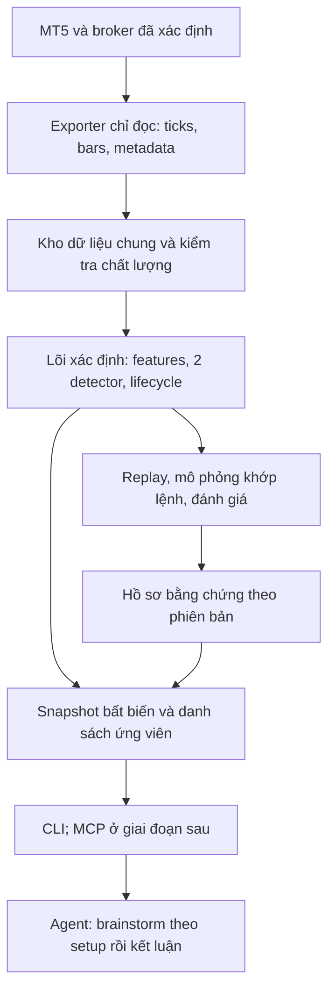

# Kế hoạch bộ công cụ quant MT5 dùng chung cho agent

Ngày lập/cập nhật: **03/11/2026**. Trạng thái: **kế hoạch và đặc tả v0.2**. Bản này giữ nguyên hai setup seed v0.1, thêm bước brainstorm và dữ liệu bối cảnh; collector/scanner mới vẫn đang ở mức đặc tả.

## 1. Mục tiêu và lựa chọn chính

Xây một bộ công cụ để Codex, Claude hoặc agent khác có thể đọc cùng dữ liệu MT5, rà soát nhiều sản phẩm, phát hiện setup, trình bày điểm vào, mức vô hiệu, SL/TP và giải thích bằng chứng tại đúng thời điểm quan sát. Bắt đầu với hai họ chiến lược: **đa khung thời gian** và **Price Action/mẫu nến**.

Các ví dụ và thống kê của bên thứ ba được dùng để hiểu hướng tiếp cận. Kế hoạch không lấy bảng thành tích ấy làm kết quả của hệ thống này.

### Bảy quyết định cho phiên bản đầu

1. **MT5 là nguồn dữ liệu giá chính.** Không cần footprint, MotiveWave, dữ liệu futures hay quy đổi giá giữa hai nguồn cho hai setup này.
2. **Một lõi tính toán dùng chung.** Agent gọi công cụ rồi diễn giải; mọi agent nhận cùng phiên bản dữ liệu và quy tắc sẽ nhận cùng kết quả kỹ thuật.
3. **Hai detector đầu tiên:** phá vùng H1 rồi retest M5; fakey M5 tại mức giá biết trước. Đây là giả thuyết nghiên cứu, chưa có lợi thế được chứng minh trên tài khoản của mình.
4. **Tách phát hiện setup khỏi quyết định dùng vốn.** Ghi tất cả ứng viên, cả những cái bị loại do spread, độ trễ hoặc giới hạn vị thế. Nhờ vậy biết hệ thống đang bỏ lỡ cơ hội ở đâu.
5. **Đo cả lợi nhuận, rủi ro và số cơ hội.** Không tối ưu riêng tỷ lệ thắng; không thêm liên tiếp nhiều bộ lọc cho đến khi gần như hết lệnh.
6. **CLI và dữ liệu có cấu trúc trước.** Giao diện MCP chỉ thêm sau khi bộ công cụ gốc ổn định. Dùng lại đường dữ liệu và cách trao đổi thư mục đã có nếu đáp ứng yêu cầu.
7. **Thêm một bước brainstorm trong mỗi lần phân tích setup.** Agent lấy volume, ATR và bối cảnh phù hợp, cân nhắc kịch bản thuận/nghịch, nêu điều kiện làm đổi nhận định rồi kết luận vào/chờ/bỏ. Đây là bước bổ sung vào cùng phương pháp đã bàn.

Tài liệu đi kèm:

- [Quy tắc chính xác của hai setup](quant-mt5-agent/references/setup-specs.md).
- [Bước brainstorm và dữ liệu bối cảnh](quant-mt5-agent/references/brainstorm-context.md).
- [Dữ liệu, giao diện công cụ và quy trình kiểm định](quant-mt5-agent/references/data-tools-validation.md).
- [Bản nháp skill dùng chung cho agent](quant-mt5-agent/SKILL.md).
- [Gói chuẩn bị bàn giao Claude](../codex_outbox/codex_018_quant_mt5_brainstorm_handoff.md).

## 2. Từ nghiên cứu chuyên gia đến thiết kế của mình

| Nguồn | Điều có thể học | Quyết định thiết kế và giới hạn suy luận |
|---|---|---|
| Alexander Elder, *Trading for a Living*, Triple Screen; [nhà xuất bản Wiley](https://www.wiley.com/en-us/trading-for-a-living-psychology-trading-tactics-money-management-p-9780471592242) | Giao cho các khung những nhiệm vụ khác nhau. | H1 mô tả trạng thái/sự kiện, M5 xác nhận phản ứng và thời điểm vào. Bộ lọc theo sự kiện là giả thuyết của mình; không phải bản sao nguyên hệ thống Elder. |
| Lo, Mamaysky, Wang, [nghiên cứu về nhận dạng mẫu giá bằng thuật toán](https://www.nber.org/papers/w7613) | Mẫu biểu đồ phải được định nghĩa thành phép đo, rồi so phân phối lợi suất có điều kiện với đối chứng. | Viết detector xác định, ghi cả mẫu đạt và không đạt. Kết quả trên cổ phiếu Mỹ không chứng minh lợi nhuận scalp vàng/FX sau phí. |
| Carol Osler, [hỗ trợ/kháng cự trong FX intraday](https://www.newyorkfed.org/research/epr/00v06n2/0007osle.html) | Mức giá được xác định trước có thể chứa thông tin; hiệu quả khác nhau giữa thị trường và nguồn mức giá. | Thử mẫu nến tại mức biết trước, rồi đo phần cải thiện so với cùng mẫu ở mọi vị trí. Không vẽ lại vùng sau khi đã thấy phản ứng. |
| Marshall, Young, Rose, [kiểm định chiến lược nến trên mẫu DJIA](https://www.sciencedirect.com/science/article/pii/S0378426605002116) | Có mẫu nghiên cứu mà quy tắc nến không tạo thêm giá trị. | Tên nến không đủ để kết luận có edge. Cần đo riêng mẫu, vị trí và thời điểm; kết quả tiêu cực ở mẫu này cũng không phủ định mọi thị trường. |
| Andersen, Bollerslev, [tính chu kỳ trong ngày của biến động](https://www.sciencedirect.com/science/article/pii/S0927539897000042) | Phân phối biến động thay đổi theo thời điểm trong ngày. | Ghi giờ/phiên theo lịch DST và so cùng điều kiện thời gian. Chọn được giờ có biến động chưa đồng nghĩa chọn được giờ có lợi nhuận. |
| Sullivan, Timmermann, White, [data snooping trong quy tắc kỹ thuật](https://onlinelibrary.wiley.com/doi/10.1111/0022-1082.00163); Bailey, López de Prado, [Deflated Sharpe Ratio](https://www.davidhbailey.com/dhbpapers/deflated-sharpe.pdf) | Chọn người thắng sau nhiều lần thử có thể thổi phồng thành tích. | Lưu mọi lần thử, kể cả chọn symbol, giờ, bộ lọc và exit; khai báo so sánh chính trước khi chạy. DSR/PBO chỉ dùng khi dữ liệu và giả định phù hợp. |

**Tư duy cốt lõi:** biến một ý tưởng giao dịch thành chuỗi câu hỏi có thể bác bỏ: điều kiện nào đang có, điều kiện đó biết từ khi nào, hành động gì, chi phí bao nhiêu, và có hơn phương án đơn giản hơn không?

Không suy ra thanh khoản toàn thị trường, vị thế tổ chức, hấp thụ lệnh hay ý đồ “săn stop” từ nến CFD. Fakey ở đây là hình học giá phá rồi quay lại. [Mô tả của Nial Fuller](https://www.learntotradethemarket.com/trading-videos/forex-systems-course-the-fakey-setup-reversal-bar-entry) được dùng để tham khảo định nghĩa mẫu.

## 3. Hệ thống sẽ hoạt động ra sao?

### Phân công giữa máy tính và agent

| Thành phần | Trách nhiệm |
|---|---|
| Collector | Lấy đúng tài khoản/server/symbol, đồng bộ lịch sử, phát hiện thiếu dữ liệu. |
| Engine | Tính chỉ báo, nhận dạng setup, SL/TP dự kiến, trạng thái còn hiệu lực. |
| Simulator/evaluator | Đo khớp lệnh, chi phí, lợi nhuận, drawdown, sai số và đối chứng. |
| Agent | Đọc setup/bằng chứng, yêu cầu thêm context phù hợp, brainstorm kịch bản và phản chứng, đề xuất vào/chờ/bỏ có lý do, ghi nhận định để học từ kết quả. |
| Người dùng | Chọn danh sách sản phẩm, giờ quan sát, giới hạn rủi ro và cách sử dụng kết quả. |

Scanner là tiến trình thông thường chạy liên tục khi được triển khai. Chat agent không cần ngồi suy luận lại trên từng tick. Hai agent có thể giải thích khác cách, nhưng không được tự sửa giá, quy tắc hoặc xác suất thắng.

### Bước brainstorm được đặt ở đâu?

**Nhận dạng cùng setup → đọc context → brainstorm → kiểm tra lại plan/chi phí → kết luận.** Agent được quyền thấy một cơ hội kỹ thuật hợp lệ nhưng khuyên chờ hoặc bỏ theo bối cảnh, với lý do có thể truy xuất. Journal lưu cả điều kiện baseline và nhận định agent; thay đổi định tính không tự trở thành một gate đã được kiểm định.

Core context ưu tiên: ATR M5/H1, tick/real volume có nhãn nguồn, RVOL, hình học nến, khoảng tới vùng, spread/R và thời điểm phiên/tin. EMA, ADX/DI, RSI, realized volatility hay VWAP có thể bổ sung khi trả lời một câu hỏi cụ thể; mỗi feature ghi công thức, timeframe, as-of và giới hạn. Phần lớn chỉ số tính từ raw MT5 thay vì tải lại cho từng agent. Chi tiết và ví dụ nằm trong [tài liệu brainstorm](quant-mt5-agent/references/brainstorm-context.md).

### Kết nối MT5

Ưu tiên một **exporter MQL5 chỉ đọc gắn vào terminal được chọn rõ**, xuất dữ liệu nguyên tử ra thư mục dùng chung; Python đọc và phân tích. Kiểm tra compiler/runtime sẵn có trước khi chốt cách tích hợp. Nếu bridge Python hiện hữu đã đáp ứng hợp đồng dữ liệu thì có thể dùng lại sau kiểm chứng, tránh viết thêm một đường dữ liệu không cần thiết.

Exporter nhiều symbol phải đồng bộ bằng `CopyTicks*`; không đếm sự kiện `OnTick` để coi là toàn bộ tick. Tài liệu chính thức nói sự kiện này gắn với symbol của chart và có thể không xếp thêm sự kiện khi đang xử lý. [MQL5 OnTick](https://www.mql5.com/en/docs/event_handlers/ontick).

MT5 cung cấp trường dữ liệu cần cho hai detector, nhưng độ sâu lịch sử, tick Bid/Ask, đặc tả hợp đồng và chất lượng phụ thuộc broker/symbol. Audit quyết định đoạn nào đủ dùng. Tick volume không mặc nhiên là volume giao dịch toàn thị trường. [MT5 bars](https://www.mql5.com/en/docs/python_metatrader5/mt5copyratesrange_py), [symbol metadata](https://www.mql5.com/en/docs/python_metatrader5/mt5symbolinfo_py).

## 4. Hai setup đầu tiên

### A. Đa khung: phá vùng → xác nhận H1 → retest M5

**Câu hỏi H1:** thị trường đã có nến đóng chấp nhận giá ngoài vùng tham chiếu được xác định trước chưa, và sự kiện còn mới không?

**Câu hỏi M5:** sau cú phá, giá đã quay về kiểm tra vùng và phản ứng theo chiều tiếp diễn chưa?

- Vùng tham chiếu: đỉnh/đáy của tám H1 hoàn tất tại/trước mốc neo và đã có khi kích hoạt anchor; đóng băng cho episode.
- M5 tạo episode phá vùng và ghi toàn bộ lần retest hợp lệ.
- Nhánh đa khung chỉ chọn ứng viên sau khi H1 đóng xác nhận cùng biên, trong thời hạn episode.
- SL nằm ngoài nến retest theo đúng phía Bid/Ask; TP cơ sở và thời gian thoát dùng chung để so sánh.
- Đối chứng: cùng các ứng viên M5, lần lượt không dùng gate, lọc hướng H1, và gate theo sự kiện H1.

**Lý do chọn:** có mốc giá, có thời điểm được phép đánh, có sự kiện làm giả thuyết hết hiệu lực. Có thể đo rõ H1 thêm giá trị gì. Gate có thể làm ít lệnh hoặc vào muộn hơn; đó chính là điều phải đo.

### B. Price Action: fakey M5 tại đỉnh/đáy ngày trước

**Câu hỏi mẫu nến:** một inside bar có bị phá qua biên mother bar rồi đóng trở lại bên trong không?

**Câu hỏi vị trí:** việc phá thất bại đó có xảy ra tại đỉnh/đáy D1 đã hoàn tất và biết trước mẫu không?

- Bắt đầu với biến thể ba nến chặt: mother → inside → nến phá thất bại.
- Long tại đáy ngày trước, short tại đỉnh ngày trước; dùng D1 của broker có ghi rõ ranh giới ngày.
- Đối chứng: mẫu đơn thuần; thêm vị trí; thêm cửa sổ thời gian định trước.
- Chỉ sau khi định nghĩa này có kết quả rõ mới xem xét pin bar, engulfing, nhiều inside bar hoặc sweep không có inside bar.

**Lý do chọn:** kiểm tra trực tiếp xem bối cảnh có giúp một mẫu nến đơn giản hay không. Bổ sung giả thuyết đảo chiều ngắn hạn cho setup A thiên về tiếp diễn.

Các con số như 8 H1, ATR14, vùng đệm hay TP 1,5R là **mốc khởi đầu để đăng ký phép thử**, không phải tham số do chuyên gia chứng nhận. Quy tắc chính xác và cách xử lý trường hợp biên nằm trong [đặc tả setup](quant-mt5-agent/references/setup-specs.md).

## 5. “Hợp từng sản phẩm” được hiểu thế nào?

Đề xuất pilot **XAUUSD, EURUSD, USDJPY**, sau khi xác minh tên thật và lịch sử trên broker. Đây là danh sách đề xuất, chưa phải inventory đã kiểm tra của terminal.

| Phần dùng chung | Phần phải biết theo từng sản phẩm |
|---|---|
| Ý nghĩa setup, trạng thái episode, đối chứng, cách đánh giá | Tick size, contract size, profit currency, volume step, stops/freeze level, phiên mở cửa |
| Quy tắc theo ATR và mốc giá biết trước | Spread/commission/slippage, độ sâu tick, lịch nghỉ/rollover |
| Quy trình chứng minh lợi thế | Kết quả theo symbol, phiên và chiều lệnh; khả năng chuyển sang symbol khác |

Chuẩn hóa khoảng cách theo ATR giúp so thang đo; nó không làm các thị trường giống nhau. Không mặc định XAU dùng tốt thì mọi FX/CFD dùng tốt. Ưu tiên cấu trúc chung, kiểm tra khả năng chuyển thị trường, rồi mới cân nhắc điều chỉnh riêng có bằng chứng.

Mở rộng từng nhóm sau pilot: FX majors → kim loại khác → chỉ số/dầu nếu broker có đủ dữ liệu và đặc tả. Không loại sản phẩm chỉ vì nhìn thấy kết quả xấu rồi gọi danh sách còn lại là lựa chọn định trước.

## 6. Trải nghiệm khi yêu cầu agent quét thị trường

Ví dụ yêu cầu: “Quét danh sách tối nay, tìm hai setup v1, cho biết cái nào đang chờ và cái nào đã xác nhận.”

Luồng xử lý:

1. Kiểm tra nguồn dữ liệu, thời điểm cập nhật, trạng thái thị trường và danh sách symbol.
2. Lấy một snapshot nhất quán; quét đúng phiên bản setup.
3. Đọc mọi ứng viên còn hiệu lực và lý do bị chặn; lấy thêm volume/ATR/context thực sự liên quan.
4. **Brainstorm trên chính setup:** kịch bản ưu tiên, khả năng đối nghịch, dữ kiện ủng hộ/chống lại và điều kiện làm đổi nhận định; chọn vào/chờ/bỏ có lý do.
5. Kiểm tra plan và giới hạn danh mục; trình bày trạng thái kỹ thuật cùng nhận định agent. Nếu thiếu dữ liệu thì nói rõ phần thiếu.
6. Trước khi người dùng hành động, cập nhật quote và kiểm tra lại SL/TP, spread, độ trễ, mức vô hiệu. Giữ bản phân tích cũ và ghi analysis note để replay.

Một thẻ cơ hội nên trả lời đủ những câu này:

| Mục | Nội dung cần có |
|---|---|
| Sản phẩm / chiều / setup | Tên broker đã xác minh; A hoặc B; trạng thái chờ hay xác nhận |
| Vì sao xuất hiện | Mốc giá, các nến đã đóng, bối cảnh và thời điểm |
| Brainstorm | Kịch bản ưu tiên/đối nghịch, volume/ATR hoặc phép đo liên quan, dấu hiệu làm đổi quyết định |
| Vào thế nào | Giá Bid/Ask hiện tại, cửa sổ vào, điều kiện không đuổi giá |
| Sai ở đâu | Mức vô hiệu cấu trúc, SL hợp lệ theo broker |
| Thoát thế nào | TP cơ sở, cản biết trước trên đường đi, thời gian giữ tối đa |
| Chi phí và rủi ro | Spread theo R, phí, dữ liệu tin tức, trùng exposure với lệnh khác |
| Bằng chứng | Phiên bản đã kiểm định đến đâu, trên symbol nào, độ bất định |

ID và thời điểm dữ liệu đặt ở cuối thẻ để truy xuất. Không đưa điểm “AI tự tin 92%” khi chưa có mô hình được hiệu chuẩn. Không có setup vẫn là kết quả hợp lệ; phải phân biệt không có mẫu với scanner lỗi hoặc thiếu dữ liệu.

## 7. Kiểm định thế nào để kết quả đáng tin?

### 7.1 Tính đúng trước, lợi nhuận sau

- Chỉ sử dụng dữ liệu đã có tại thời điểm quyết định; H1 chưa đóng không được dùng giá trị đóng cuối cùng.
- Chạy lại từng đoạn dữ liệu phải cho đúng kết quả mà scanner đã phát tại đoạn đó.
- Mô phỏng buy vào Ask, thoát Bid; sell vào Bid, thoát Ask; tính phí và trượt giá rõ ràng.
- Nến vừa chạm SL vừa chạm TP phải kiểm tra tick. Khi không đủ tick thì gắn cờ không biết thứ tự và báo độ nhạy; không tự chọn phía có lợi.
- Đánh giá cả độ trễ nhận cảnh báo và thao tác. Giá đẹp trên nến không đủ nếu khi nhận phân tích đã đi xa.

Strategy Tester có thể sinh tick khi một phút có bar nhưng thiếu tick thật. Nhãn chế độ tester không tự chứng minh mọi phút đều có tick thật; cần báo coverage riêng. [MT5 real/generated ticks](https://www.metatrader5.com/en/terminal/help/algotrading/tick_generation).

### 7.2 Dữ liệu lịch sử trong workspace

`PROTOCOL.json` của dự án cũ ghi XAUUSD từ **23/10/2021 đến 23/10/2026** đã được dùng nghiên cứu. Có thể dùng lại để kiểm tra logic, phát hiện lỗi và đánh giá theo thứ tự thời gian; phải ghi đây là lịch sử đã tiếp xúc. Không lấy các năm đó đặt lại tên thành tập kiểm chứng cuối cùng chưa từng xem.

Mỗi dataset có sổ ghi ai đã dùng, dùng vào việc gì, thời điểm nào, phiên bản nào. Nếu tìm được dữ liệu thực sự chưa dùng thì khóa trước khi phát triển; nếu không, bằng chứng mới đến từ **paper forward sau khi đóng băng phiên bản**.

### 7.3 So sánh và báo cáo

Lô nghiên cứu đầu có sáu cấu hình phát hiện/điều kiện, giữ chung exit và chi phí:

| Mã | Cấu hình | Câu hỏi |
|---|---|---|
| M0 | Retest M5 không có gate H1 | Ứng viên nền có đặc điểm gì? |
| M1 | M0 + lọc hướng H1 EMA50 | Lọc hướng đơn giản thay đổi gì? |
| M2 | M0 + xác nhận sự kiện H1 | Gate theo sự kiện có hơn M0/M1 sau chi phí và độ trễ? |
| P0 | Fakey ba nến ở mọi vị trí | Bản thân mẫu có thông tin/lợi nhuận gì? |
| P1 | P0 + mức D1 biết trước | Vị trí có thêm giá trị? |
| P2 | P1 + 08:00–11:00 America/New_York | Giờ định trước có thêm giá trị khi đã có vị trí? |

P2 là giả thuyết ban đầu về thời gian, có điều chỉnh DST; không kết luận đây là giờ tốt nhất. Bảng trên không đủ để tách mọi tương tác giữa vị trí và thời gian. Thử thêm cấu hình là lần thử mới cần ghi sổ.

Bước brainstorm v0.2 bổ sung cách đọc từng cơ hội, giữ nguyên sáu cấu hình baseline. Journal tách nhận định/agent action với kết quả detector; nếu sau này một luận điểm volume/ATR được chuyển thành gate tự động thì đăng ký phép thử tăng thêm riêng.

Sau khi chọn hoặc giữ nguyên phiên bản theo quy trình đã khai báo, đánh giá thêm **một danh mục kết hợp A+B** trên khoảng dữ liệu kế tiếp còn hợp lệ. Đây là một phép thử riêng, không suy lợi ích cộng gộp từ hai bảng kết quả độc lập.

Thước đo bắt buộc:

- Lợi nhuận ròng theo R/lệnh và theo ngày trên cùng lịch, gồm ngày không giao dịch; expectancy và khoảng bất định.
- Drawdown của equity gồm lỗ nổi, losing streak, worst day, thời gian hồi phục.
- Số setup, số ứng viên đủ điều kiện, số lệnh thực sự khả thi và số cơ hội/tuần vào giờ người dùng quan sát.
- Chi phí/R, độ trễ, phần giá đã chạy trước entry, thời gian giữ, MAE/MFE.
- Kết quả theo symbol, chiều, phiên, giai đoạn; mức tập trung lợi nhuận vào vài ngày/sản phẩm.
- Phần tăng/giảm lợi nhuận và rủi ro khi thêm gate hoặc ghép hai setup; toàn bộ danh sách cấu hình đã thử.

Bootstrap theo block ngày/phiên, giữ các symbol tương quan cùng block. So các cấu hình bằng chênh lệch lợi nhuận trên cùng ngày, thay vì coi từng lệnh là quan sát độc lập. Kiểm định nhiều giả thuyết phải xử lý theo toàn bộ phạm vi tìm kiếm đã ghi, không chỉ sáu cấu hình công bố.

### 7.4 Các mức kết luận

| Trạng thái bằng chứng | Được hiểu là |
|---|---|
| RESEARCH | Ý tưởng có quy tắc rõ, đang cần kiểm chứng. |
| ENGINE_VERIFIED | Tính toán và replay vượt qua kiểm tra kỹ thuật; chưa kết luận edge. |
| HISTORICAL_PROMISING | Kết quả lịch sử sau phí có triển vọng, còn giới hạn exposure/độ bất định. |
| FORWARD_SUPPORTED | Có bằng chứng từ dữ liệu mới thu sau freeze, đáp ứng tiêu chuẩn đã đăng ký. Luôn ghi thời gian, symbol, chi phí và sai số. |

`INCONCLUSIVE` và `REJECTED` là kết luận của từng phép thử. Dữ liệu tốt không tự làm chiến lược tốt; một setup kỹ thuật hoàn chỉnh vẫn có thể chưa có bằng chứng lợi nhuận.

Không dùng số lệnh cố định như 30/100/400 làm bảo đảm thống kê. Quyết định phụ thuộc độ bất định, số ngày/sự kiện độc lập, mức phụ thuộc, chi phí và rủi ro. Nếu khoảng tin cậy vẫn rộng thì tiếp tục paper với phiên bản đóng băng; không gọi việc chưa đủ bằng chứng là chiến lược đã thất bại.

## 8. Lộ trình triển khai và điều kiện nghiệm thu

Đây là thứ tự công việc theo phụ thuộc. Thời gian có bằng chứng thị trường phụ thuộc số cơ hội xuất hiện, nên không cam kết đạt edge sau một số ngày cố định.

| Mốc | Công việc cụ thể | Sản phẩm bàn giao / điều kiện hoàn tất |
|---|---|---|
| **B0 — Khóa phạm vi** | Chốt terminal, broker, 3 symbol pilot, giờ quan sát; kiểm kê code có thể dùng lại; ghi lịch sử dữ liệu đã tiếp xúc. | Inventory thật; bảng dùng lại/viết mới; không kế thừa ngầm tham số hoặc gate dự án cũ. |
| **B1 — Đường dữ liệu và context** | Export metadata, bars có volume/spread, tick theo lô; chuẩn hóa thời gian/quote side; tính core ATR/RVOL/geometry, cursor và coverage. | Manifest; feature có nguồn/đơn vị/as-of; phân biệt tick/real volume; phát hiện gap/stale; không bỏ tick cùng mili giây. |
| **B2 — Hai detector** | Viết cùng các quy tắc ở đặc tả; xuất raw catalog độc lập từng gate; lifecycle và dedup. | Fixture long/short, biên giờ/ngày, prefix replay và restart đều đúng; từng signal chỉ ra nến và mức nguồn. |
| **B3 — Replay và chi phí** | Mô phỏng quote-side, SL/TP/gap, phí, chờ thao tác, portfolio; đối chiếu các ca với MT5. | Ledger từ signal → quote → fill → exit; không lỗi causality; báo ca chưa xác định do tick thiếu. |
| **B4 — Nghiên cứu sáu cấu hình** | Đăng ký câu hỏi/thước đo/split; chạy lịch sử theo thời gian; block bootstrap, stress, báo frequency. | Báo cáo có cả kết quả không tốt, khoảng bất định và nhãn exposure đúng; quyết định giữ/sửa/bỏ có lý do. |
| **B5 — Scanner paper dùng được** | CLI scan/context/detail/replay; snapshot chung; thêm bước brainstorm và analysis note vào thẻ cơ hội; freeze phiên bản. | Hai agent dùng cùng số liệu kỹ thuật; brainstorm có phản chứng/hành động rõ; replay được note và signal. |
| **B6 — Forward và cải tiến** | Ghi mọi lần phát, đủ/thiếu dữ liệu, hành động giả lập/thực tế nếu người dùng cung cấp; phân tích drift. | Báo cáo dữ liệu mới sau freeze, chi phí/độ trễ thực tế; đủ bằng chứng mới nâng mức kết luận. |

### Các đầu việc nên giao khi bắt đầu code

1. **Người/agent dữ liệu:** B0–B1, chịu trách nhiệm identity và nghĩa của dữ liệu.
2. **Người/agent xây engine:** B2–B3, chịu trách nhiệm quy tắc xác định và ledger khớp lệnh.
3. **Người/agent phản biện:** kiểm tra độc lập khả năng nhìn tương lai, quote-side và đối chứng trước B4.
4. **Người/agent nghiên cứu:** đăng ký, phân tích và kết luận B4/B6; không sửa detector để hợp bảng thành tích giữa chừng.
5. **Người/agent vận hành:** B5, chất lượng dữ liệu và luồng trình bày cho người dùng.

Đây là vai trò có thể do Codex, Claude hoặc người đảm nhiệm; không bắt buộc có năm agent hay tạo thêm chat. Mỗi thay đổi có một người chịu trách nhiệm, phiên bản và người review khi cần. Không cho nhiều agent cùng sửa một file/quy tắc mà không có chủ thay đổi rõ ràng.

### Dùng lại dự án hiện có một cách có chọn lọc

- Xem xét `scripts/gold_v301_causal_core.py`, `scripts/verify_mt5_parity.py`, các script bootstrap/walk-forward và test causality hiện có.
- Xem xét các module `Risk.mqh`, `Journal.mqh`, `Time.mqh`, `StopRules.mqh` trong Cản Hỗ Trợ v4.
- Phải kiểm tra giả định spread, slippage, M1 intrabar, symbol/contract hardcode và tính độc lập của detector trước khi tái dùng.
- Quy tắc giữ 100% tín hiệu và giới hạn giá tuyệt đối của XAU trong `PROTOCOL.json` thuộc nghiên cứu cũ. Phiên bản quant này cần protocol riêng.

## 9. Quy tắc nâng cấp để các phương pháp bổ trợ nhau

Một module mới phải có **một nhiệm vụ và một phép so sánh**:

| Hướng nâng cấp | Câu hỏi phải trả lời trước khi đưa vào dùng |
|---|---|
| Khung lớn bổ sung | Nó bổ sung thông tin gì so với setup đang có, hay chỉ diễn đạt lại cùng hướng giá? |
| Mẫu nến mới | Nó tạo thêm cơ hội/sự kiện khác hay đếm lại cùng cú giá chạy? |
| Giờ/phiên hoặc biến động | Lợi ích ròng sau phí có giữ ngoài giai đoạn chọn tham số? Mất bao nhiêu cơ hội? |
| Break-even/trailing/runner | Cải thiện phân phối lợi nhuận/drawdown khi dùng tick Ask/Bid và độ trễ thực tế? |
| Chọn riêng sản phẩm | Có dữ liệu đủ để phân biệt hiệu ứng sản phẩm với may mắn do chọn mẫu? |
| Ghép setup | Tăng cơ hội hoặc giảm rủi ro danh mục sau khi khử trùng và giữ cùng tổng ngân sách rủi ro? |

Không mặc định nhiều điều kiện AND làm chiến lược tốt hơn. Cũng không mặc định kết hợp hai setup làm đa dạng hóa: cùng symbol/cùng sự kiện chỉ được tính rủi ro một lần, và nhiều lệnh USD có thể cùng một exposure.

Exit mới, lựa chọn symbol và cách xếp hạng mới đều là phiên bản/phép thử mới. Chưa cần ML, mô hình đoán xác suất, hàng chục indicator hay một agent riêng cho từng cây nến ở giai đoạn đầu.

## 10. Giữ hệ thống nhẹ và dễ bảo trì

- Dùng một kho dữ liệu chung, phân vùng theo broker/symbol/ngày; không chép cả lịch sử cho từng agent hoặc backtest.
- Bars để sàng lọc; tick được tải theo từng đoạn cần thiết cho replay và kiểm chứng thực thi. Mọi khoảng giữ lại đều có coverage, không ngầm bỏ những đoạn tick bất lợi.
- Lưu raw bất biến, kết quả dẫn xuất có thể tái tạo; export tăng dần với checkpoint, xử lý theo lô nhỏ.
- Mỗi run lưu manifest, config, kết quả gọn và đường dẫn nguồn; không nhân bản terminal MT5 hoặc tạo bản copy dữ liệu lớn để “cho chắc”.
- Đặt ngân sách dung lượng theo dung lượng trống thật và nhắc khi vượt; dọn cache có thể tái tạo trước. Chính sách lưu tick thô phải thống nhất trước khi xóa để không làm mất khả năng tái lập.

## 11. Bước triển khai đầu tiên nên làm

**B0 + phần nhỏ B1:** tạo audit chỉ đọc cho terminal và ba symbol pilot, xuất một manifest dữ liệu cùng một snapshot mẫu. Sau đó mới code detector A và B từ cùng hợp đồng dữ liệu.

Phần chuẩn bị có thể dùng lại raw bars đã lưu với tick_volume/real_volume/spread để audit và minh họa context. Mẫu từ kho cũ phải có nhãn historical/exposed; không coi là quote hiện tại. Gói bàn giao Claude cần nêu rõ giữ nguyên setup, thêm brainstorm và công việc B0/B1 có thể kiểm tra.

### Bằng chứng chuẩn bị đã có ở lần cập nhật v0.2

[PREP_DATA_AUDIT.json](PREP_DATA_AUDIT.json) ghi nguồn/hash và kết quả đọc thật: XAUUSD 357.782 M5, EURUSD 60.666 M5, USDJPY 60.665 M5. Cả ba archive có tick_volume; real_volume toàn 0 trong phạm vi các tệp đã kiểm tra. Đã tính minh họa ATR/RVOL từ mẫu có nhãn historical, chưa tải dữ liệu broker mới.

[COMMUNICATION_STATE.json](COMMUNICATION_STATE.json) ghi phiên Claude và phương thức phát hiện qua CLI. [Gói bàn giao](../codex_outbox/codex_018_quant_mt5_brainstorm_handoff.md) sẵn trong thư mục chung; trạng thái nhận việc phải dựa vào ACK thực của Claude.

Kết quả đầu tiên cần nhìn thấy là: “đây là nguồn giá nào, đoạn nào đủ dữ liệu, tại thời điểm này engine biết gì, và có thể phát lại đúng những gì nó biết”. Khi nền này rõ, việc thêm setup mới sẽ bớt rối và có thể đánh giá được phần đóng góp của nó.
