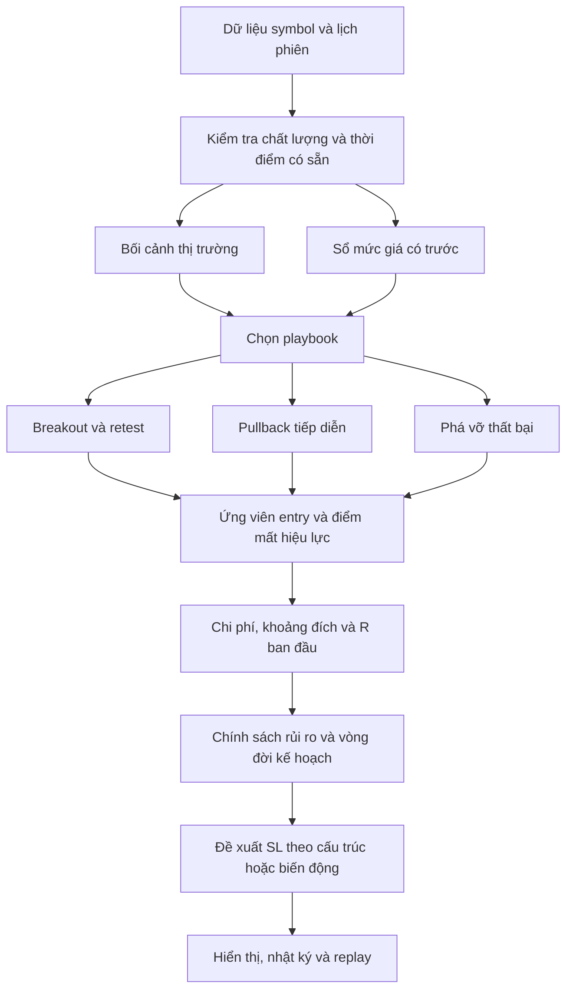

# Bản đồ cấu trúc indicator để chuẩn bị thảo luận

Ngày 25/10/2026. Đây là đặc tả nghiên cứu; không có phần nào trong tài liệu này đã được chép vào mã indicator.

## Những quan sát trực tiếp từ phiên bản scalp v3.12

| Quan sát trong mã | Hệ quả cần đánh giá |
|---|---|
| H1/M5, sweep, CHoCH và trend/distance tập trung trong `DetectLtfConfirmation` | Một chuỗi tín hiệu chính; chưa thể kết luận mọi loại cơ hội đều được bao phủ |
| Chế độ scalp cho `tp2 = tp1` | Thay số TP không tự tạo quản lý runner |
| `ManageActiveSignal` có bảo vệ BE nhưng chưa có vòng trailing theo mỗi cấu trúc mới | Cần mô hình stop động có trạng thái và thời điểm hiệu lực |
| `SConfirmSignal` đã có `initialSl` | Có thể làm cơ sở giữ R ban đầu; vẫn phải phân biệt planned entry và fill |
| Có một `g_lastSignal`; khi đang active sẽ bỏ một tín hiệu mới khác khóa | Nhận diện cơ hội và chính sách giữ vị thế đang liên quan chặt; cần tách khi đo tần suất |
| Macro target có giá dự phòng entry ±4,5R khi chưa tìm được cản phù hợp | Giá dự phòng không được coi là cản quan sát để chứng minh room |
| Kiểm tra MinRR dựa trên TP được tạo; macro RR không phải cùng cổng đó | Cần lớp kiểm tra cản/đích có nguồn gốc trước khi kết luận setup đủ 1,5R |

Nguồn đối chiếu: [inputs](<D:/trading thử lần cuối cuối/duc_tri_can_ho_tro_scalp.mq5:109>), [SConfirmSignal](<D:/trading thử lần cuối cuối/duc_tri_can_ho_tro_scalp.mq5:216>), [target/macro](<D:/trading thử lần cuối cuối/duc_tri_can_ho_tro_scalp.mq5:1310>), [khóa tín hiệu](<D:/trading thử lần cuối cuối/duc_tri_can_ho_tro_scalp.mq5:1394>), [management](<D:/trading thử lần cuối cuối/duc_tri_can_ho_tro_scalp.mq5:1515>).

Đây là đọc mã để định vị thiết kế, không phải audit toàn bộ bản v4 multiasset hoặc kết quả benchmark mới.

## Luồng đề nghị

Luồng này là cấu trúc mới để nghiên cứu, không phải ghép tất cả chỉ báo của các chuyên gia vào một công thức điểm.

## Các thành phần và đầu ra cần rõ

| Thành phần đề nghị | Nhận dữ liệu | Xuất kết quả | Điều bất biến |
|---|---|---|---|
| Hồ sơ symbol | Spec, quote, phiên, timezone | Đơn vị, lịch, giới hạn giao dịch, chi phí | Không có hằng số pip vàng dùng cho mọi asset |
| Bối cảnh | Nến đã đóng và mức có trước | Trend/range/compression/unknown cùng thời điểm xác nhận | Không gán regime bằng dữ liệu tương lai |
| Sổ mức giá | Swing/biên phiên/ngày/vùng | Giá mức, nguồn, thời điểm hợp lệ, hết hạn | Mức phải được biết trước sự kiện sử dụng nó |
| Router | Bối cảnh + mức | Playbook hợp lệ và lý do | Không yêu cầu các nhánh đối nghịch cùng đúng |
| Bộ nhận diện setup | Nến và các mức đã hợp lệ | Candidate, hướng, trigger, hủy, hạn chờ | Không phát lại cùng ý tưởng trên từng tick |
| Kế hoạch entry/stop | Candidate + spec + quote | Planned entry, stop ngoài cấu trúc, target có nguồn, room | Không bóp stop hoặc tạo cản giả để đủ RR |
| Sổ vòng đời | Entry/fill/stop/events | Pending/active/protected/trailing/closed | R0 cố định; trạng thái kết thúc không hồi sinh |
| Đo hiệu quả | Event log + giá fill/phí | R ròng, MFE/MAE, capture, lý do exit | Mỗi ý tưởng có một đơn vị thống kê chính |

Không chốt thuật toán scoring, trọng số hoặc ngưỡng của các thành phần này trong đợt nghiên cứu.

## Hợp đồng dữ liệu dự kiến

**Level:** level ID, symbol, loại mức, giá/vùng giá, thời gian quan sát, thời gian xác nhận, hết hạn, phiên và phiên bản nguồn dữ liệu.

**Candidate:** candidate ID, playbook ID, hướng, mức đã dùng, thời điểm trigger biết được, planned entry, initial invalidation, room tới cản, điều kiện hủy, lý do nhận/loại.

**Trade idea:** idea ID gốc, các ticket liên quan nếu có, entry/fill thực tế hoặc giả lập, initial SL, R0 theo giá/tiền, volume ban đầu, stop hiện hành, các lần sửa và thời điểm hiệu lực.

**Exit event:** quote đóng, thời gian, lý do, volume đã thoát/còn lại, phí, R đã thực hiện, MFE và MAE tính tới thời điểm đó. Không dùng đỉnh/đáy xuất hiện sau khi exit để tăng MFE của lệnh đã đóng.

**Dữ liệu kiểm định:** broker/symbol/feed, timezone, Bid/Last chart mode, real/tick volume, độ phủ tick, phiên bản luật, hash dữ liệu và giá trị thiếu.

## Vòng đời quản lý lệnh đề nghị

WATCHING → ARMED → CONFIRMED → PENDING hoặc ACTIVE → PROTECTED → TRAILING → EXITED.

PENDING có thể chuyển sang CANCELLED/EXPIRED; ACTIVE có thể thoát tại SL, target, time exit hoặc mất cấu trúc. Một số bước có thể bị bỏ qua theo policy được khai báo. Không buộc phải BE trước khi trailing nếu cấu trúc chưa cho phép.

- Stop cũ vẫn có hiệu lực trong bar đang dùng để tính stop mới.
- Nếu tick cho thấy stop đã bị chạm, không được dùng cú hồi sau đó để “sống lại” lệnh.
- Entry limit có thời điểm đặt, hết hạn và khả năng không được fill.
- Khi trượt qua stop, ghi fill bất lợi có thể vượt −1R; không mặc định luôn khớp đúng đường SL.
- Khi một ý tưởng bị bỏ vì ngân sách rủi ro, vẫn ghi candidate để biết mất tần suất ở đâu.

## Tách tín hiệu khỏi chính sách vị thế

Mục đích của sổ candidate là đo **cơ hội thị trường**, khác với số vị thế được phép giữ. Không cần tăng số lệnh đồng thời để chứng minh nhiều setup hơn. Có thể phát hiện nhiều ứng viên nhưng chỉ một kế hoạch được phép ACTIVE nếu đó là chính sách đã chọn.

Khi nhiều playbook nhận diện cùng một nhịp, phải liên kết về một idea hoặc phân xử bằng luật có trước. Không chọn nhánh cho kết quả đẹp hơn sau replay. Sau này phải đo riêng lợi ích bổ sung và tương quan giữa playbook/symbol.

## Hiển thị để người dùng quyết định

Panel đề nghị hiển thị: tên setup; bối cảnh; entry và initial SL; SL đề xuất hiện tại; khoảng đích còn lại theo R0; trạng thái chờ/xác nhận/hết hạn; lý do bỏ; MFE và lãi đã khóa theo kế hoạch. Phân biệt **đề xuất trên indicator** với lệnh hoặc SL thực tại broker.

Không hiện “xác suất thắng 85%” chỉ vì điểm hợp lưu là 85/100. Trạng thái bên trong và ID kỹ thuật phục vụ log, không cần đưa hết vào panel.

## Phần riêng cho tài khoản quỹ

Lớp rủi ro cần có hồ sơ quy tắc theo **đơn vị, loại tài khoản và ngày hiệu lực**. FTMO 2-Step hiện nêu giới hạn ngày 5%, tổng 10% theo cơ chế của gói; cách tính gói khác không đồng nhất. Equity có gồm lãi/lỗ mở và phí. [S22 — quy tắc gốc](https://ftmo.com/en/trading-objectives/)

Các mức đó là ràng buộc ví dụ, không phải mức rủi ro đề nghị sử dụng. Cần có khoảng dự phòng và xét đồng thời các ý tưởng liên quan; không lấy số dư danh nghĩa 100k làm vốn có thể mất.

## Quyết định để lại sau thảo luận

Chọn nhánh pilot; chọn độ trễ xác nhận swing; chọn trail theo cấu trúc hay ATR; có chốt từng phần không; tần suất mong muốn theo từng symbol và cả danh mục; loại tài khoản quỹ; nguồn dữ liệu và lịch phiên. Chưa có quyết định triển khai nào được suy từ việc đã hoàn thành hồ sơ nghiên cứu.
